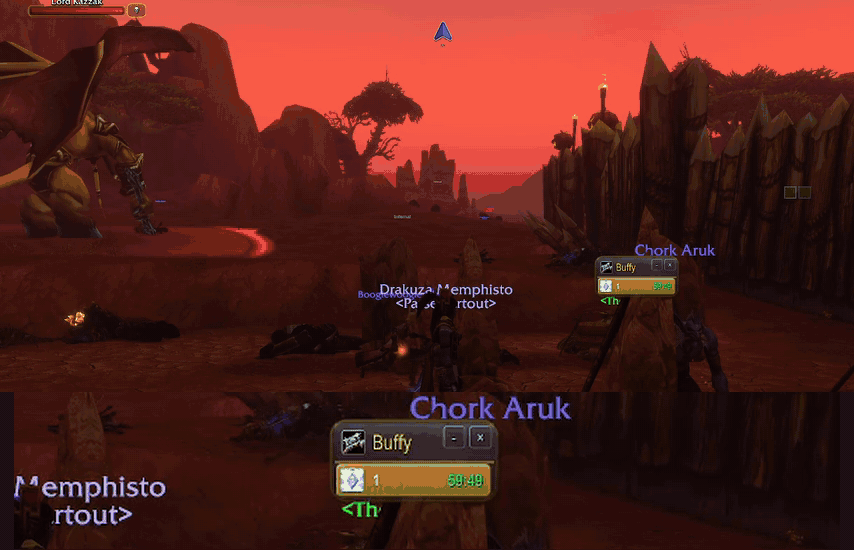
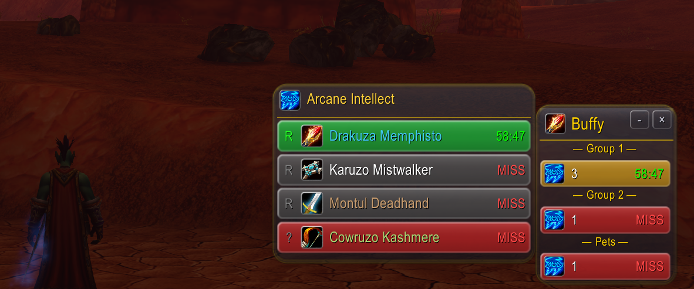

# Buffy

A group buff manager for **World of Warcraft: Forever**, automatically choosing Priest,
Druid, or Mage behavior. Buffy combines Priestly, Wildly, and Magely through their shared
LibGroupBuffs engine and LibGlass window.



| Class | Buffs |
| --- | --- |
| Priest | Fortitude, Spirit, Shadow Protection; instance and aura detection modes |
| Druid | Mark/Gift of the Wild; Thorns on tanks, yourself, everyone, automatically, or disabled |
| Mage | Intellect/Brilliance; independent Amplify and Dampen modes and instance selections |

Left-click a row to cast a group buff when learned, or a single buff otherwise. Right-click
casts a single buff on the first eligible member missing it. Hover for individual member
buttons. Reagent counters appear for the spells you know. Secure window changes wait until
combat ends. Unsupported classes create no buff window.



## Commands and settings

`/buffy` toggles the window. Available commands: `show`, `hide`, `config`, `reset`, `pos`,
`help`, and `toggle`. Help includes localized spell names and dependency diagnostics.

Settings are shared by characters of the same class. Position and visibility are per character.
Buffy starts with fresh settings and does not import settings from the original addons.
Disable the matching original addon when using Buffy to avoid duplicate buff windows.

## GlassUI

GlassUI is optional and not released yet; until it is, Buffy uses its Clean look. Once a
GlassUI version with the Buffy roster entry is available, Buffy appears in its hub while
loaded and follows its material, body tint/backing, and accent. Change its follow
switch or appearance in GlassUI, then `/reload`. Local opacity is disabled while following;
its saved value returns when following is off. Without a compatible suite, Buffy uses Clean.
Class/spec icons and buff-status colors retain their meaning.

## Development

This checkout needs the companion LibGroupBuffs implementation; see
[implementation status](docs/IMPLEMENTATION.md). A source archive without embedded libraries
is not a game installation. Build a staged package using:

```powershell
pwsh tests/run.ps1 -Library .work/LibGroupBuffs -LibGlass .work/LibGlass-r11
pwsh Tools/package.ps1 -Library .work/LibGroupBuffs -LibGlass .work/LibGlass-r11
$env:LIBGROUPBUFFS = "$PWD/.work/LibGroupBuffs"
$env:LIBGLASS = "$PWD/.work/LibGlass-r11"
python tests/check_package.py .work/package
```

The package script requires a fresh destination. Pass `-Destination` for another staging
directory. `Tools/deploy.ps1` is a separate, explicit development deployment tool.

Offline validation does not establish in-game acceptance. Use the checklist in
[docs/ACCEPTANCE.md](docs/ACCEPTANCE.md), including a full restart to verify persistence.

CurseForge project: **1760483**. Interface: **16001**. Author: **Spotnick**.
